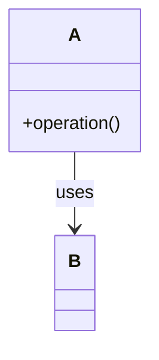

# P4 · Guía operativa de auditoría ATDD/TDD, UML evolutivo y vídeo

**Guía del alumnado.** Referencias: [contrato de aceptación](02-aceptacion.md), [rúbrica](07-rubrica-analitica.md) y [PLANTILLA_README](PLANTILLA_README_P4.md).

## 1. Finalidad y alcance de la evidencia

En parejas, el **alumno 1** mostrará un escenario significativo de **HU-02** (después de desarrollar HU-01/HU-02 hasta BDD-05d) y el **alumno 2** uno de **HU-03** (después del relevo GREEN; BDD-06–09, 10–12 y 13d). Los otros valores límite de equilibrio se comprueban mediante JUnit. Cada participante mostrará un **escenario intermedio de su etapa** que incluya un comportamiento de negocio significativo y una evolución de diseño. La evaluación principal del proceso se realiza mediante su **vídeo individual (máximo 6–7 min)**, contrastado con el historial real de Git y las ejecuciones. No basta una suite GREEN final. La entrega del grupo incluye todas las HU y una suite reproducible; cada persona demuestra su recorrido.

La técnica recomendada es **«historia de escenario con commits de hitos verificables»**: rama por incremento, mensajes en español con HU, BDD y fase, commits reales de pruebas y producción en los momentos en que se producen, y una tabla que enlaza hashes, resultados, PR, vídeo y cortes UML. Se puede elegir una técnica equivalente de auditoría sin cambiar la convención obligatoria de mensajes. No exigir una cantidad fija de commits ni convertir fallos de infraestructura en RED TDD.

## 2. Acordar una política

- Antes del primer ciclo, incorporar al `README_P4.md` la política de commits: nomenclatura, granularidad, pruebas antes de producción, criterio de commit con test rojo (solo rama de trabajo), cómo se confirma GREEN y dónde se anotan las ejecuciones.
- Partir de la última versión GREEN de la rama de integración. **no comienza HU-03 hasta disponer del commit integrado y GREEN**.
- **Commit RED auténtico:** versión del test JUnit que falla por ausencia de implementación o una aserción; guardar el diagnóstico (nombre de test y razón). Si el test no compila, su evidencia es RED de compilación por API aún inexistente, *no* prueba de ejecución fallida.
- **Commit GREEN auténtico:** código mínimo para hacer pasar ese test junto con los anteriores; ejecutar el subconjunto pertinente. Si son precisos dos microciclos, registrar ambos.
- **Commit REFACTOR:** mejora de responsabilidades o extracción al dominio sin cambiar comportamiento; ejecutar regresión. Los nuevos tests de caracterización de conducta ya existente pueden nacer verdes. Cuando aparezca una regla nueva, requiere otro test RED antes del código.
- **Ciclo exterior:** guardar escenario Gherkin antes del código, ejecución inicial `undefined/pending` o fallo; automatizar glue y oráculos; después del último `Then`, ejecutar aceptación y regresión completa. Un `Then` vacío, un test desactivado o `0 tests` no son GREEN válido.

**Nomenclatura obligatoria y coherente con HU-01:** el mensaje de cada commit se redacta en **español**, con `TIPO HU-XX BDD-YY: descripción`. Los prefijos son `ATDD-TEST`, `ATDD-FEAT`, `TDD-TEST`, `TDD-FEAT` y `TDD-REFACTOR`. Es obligatorio indicar HU y BDD también en commits de JUnit y de diseño. Si el cambio afecta a varios escenarios, concatenar identificadores con `+`. Ejemplo realista de HU-03:

```text
ATDD-TEST HU-03 BDD-13d: especificar rechazo de combinado desequilibrado
TDD-TEST HU-03 BDD-13d: exigir equilibrio entre componentes
TDD-FEAT HU-03 BDD-13d: comprobar la proporción mínima en el dominio
TDD-REFACTOR HU-03 BDD-10+BDD-13d: centralizar validación de componentes
ATDD-FEAT HU-03 BDD-13d: verificar el rechazo y la ausencia de persistencia
```

`ATDD-TEST` registra especificación inicial o glue `undefined/pending`; `ATDD-FEAT` solo cuando el escenario comprueba realmente el comportamiento. Cada commit se crea después de ejecutar la prueba pertinente y antes de comenzar otra etapa. La refactorización puede actualizar juntos código y tests cuando se modifica una interfaz interna, sin alterar los resultados de negocio; conservarlos en **un solo commit lógico** si resulta posible. Las pruebas ya GREEN por comportamiento anterior no se vuelven rojas artificialmente. El formato se explica con instrucciones Git y EGit en [el laboratorio HU-01](03-laboratorio-hu01.md).

No se deben crear commits artificiales ni modificar fechas/autorías, ni reconstruir retrospectivamente un falso recorrido. La escritura de archivos temporales o snapshots solo sirve para reconstruir el estado original; deben localizarse los hashes originales con `git log`. No rebase interactivo, squash, amend ni force-push en la parte del historial que se va a presentar como evidencia auditada, salvo incidencia documentada y referencias actualizadas.

## 3. Cómo recuperar y auditar un ciclo de forma reproducible

Desde la raíz del repositorio en Windows (PowerShell), con el proyecto Maven en `ProyectoP4/`:

```powershell
git status
git branch --show-current
git log --oneline --decorate --all -- ProyectoP4/
git show --stat <HASH>
git show <HASH> -- ProyectoP4/
mvn -f ProyectoP4/pom.xml clean verify
```

Sustituir `<HASH>` por el hash real. En PowerShell los signos angulares son marcadores de documentación, **no deben escribirse literalmente**. Para comprobar un estado histórico sin alterar la rama activa, usar `git worktree add --detach ../p4-auditoria HASH_REAL`, ejecutar allí Maven, registrar el resultado y después `git worktree remove ../p4-auditoria`; si el commit RED no compila, es un resultado esperado de ese hito, no un fallo que deba repararse. Antes de crear un worktree comprobar que no haya cambios sin guardar y que la ruta sea segura. Alternativamente navegar por el diff de GitHub y enlazar la ejecución Actions del commit; el vídeo debe explicar el resultado reproducible, no simularlo.

Los comandos `git show` permiten explicar **qué cambió y por qué**. `git diff HASH_ANTERIOR HASH_NUEVO -- P4/` contrasta etapas. Cada fila de la tabla del README llevará URL permanente de commit y el identificador de la ejecución. Si el workflow solo ejecuta `verify` al publicar, se admite adjuntar el resultado local del RED (reporte y captura legibles) vinculado al hash. Si un commit RED se publica, el CI podrá fallar legítimamente en la rama de trabajo; el PR final deberá quedar GREEN.

## 4. Matriz mínima de trazabilidad

Además de los microciclos, registrar el **commit de relevo HU-02 → HU-03**, su PR, revisión, resultado CI y UML HU-02; el vídeo del segundo alumno debe partir de ese estado. Para una entrega individual se conserva el mismo hito lógico.

| Alumno | Escenario/regla | Cucumber inicial | JUnit RED y diagnóstico | GREEN mínimo | Refactorización/prueba OO | Aceptación final + regresión | PR/CI | Vídeo |
|---|---|---|---|---|---|---|---|---|
| Ejemplo orientativo | BDD-13d / RG-16 | hash + undefined/pending | hash + aserción de equilibrio | hash + test verde | hash + explicación de extracción a dominio | hash + run GREEN | enlaces | URL y 02:10–04:00 |

Una ejecución de Cucumber que aún tiene pasos undefined muestra el contrato no automatizado; el RED de JUnit es otra evidencia distinta. Identificar las pruebas de clase y de colaboración que se añadieron después.

## 5. Diagramas UML progresivos: tres cortes, más los cambios del escenario auditado

**Obligatorios tres diagramas UML de clases**, asociados a los hashes y estados reales del repositorio: tras HU-01, tras HU-02 y tras HU-03. Deben reflejar solo las clases efectivamente existentes en ese momento; la arquitectura conceptual futura, si se menciona, se distingue gráficamente como hipótesis y no se hace pasar por implementada.

Usar PlantUML, Mermaid `classDiagram`, draw.io o herramienta equivalente que permita entregar fuente editable/textual y exportación SVG/PNG visible en GitHub. Se recomienda mantener `docs/uml/hu01.md`, `hu02.md`, `hu03.md` con Mermaid para facilitar diffs; se admite PlantUML `.puml`. No hace falta dibujar todos los getters ni las clases de librerías: incluir los conceptos nuevos y relaciones relevantes.

Cada corte debe mostrar:
- **Capas o paquetes** y responsabilidad (dominio, aplicación, infraestructura; adaptador Cucumber solo si ayuda).
- **Clases/interfaces reales** y atributos/operaciones significativas para la regla. Métodos de prueba y framework no son parte del modelo de producción.
- **Relaciones UML justificadas**: herencia/generalización (línea con triángulo hueco), realización de interfaz (línea discontinua y triángulo hueco), composición/agregación solo si la semántica de ciclo de vida lo permite, asociación y dependencia cuando corresponda; multiplicidades en colecciones relevantes.
- **Evolución del diseño:** tabla corta que cite (hash anterior → hash nuevo), clase/relación añadida o cambiada, test o escenario que motivó el cambio y riesgo comprobado.
- **Propuesta combinada:** si `CombinedExercise` contiene un técnico y un físico, comprobar qué relación *tiene-un* es real y si además se integra en un contrato `Exercise` (*es-un*). No dibujar herencia entre tipos solo por sus nombres.

En el escenario de vídeo seleccionar **dos estados como mínimo** (antes y después de una refactorización o aparición de una regla), mostrar sus UML correspondientes y explicar qué test causó el cambio; pueden ser recortes de los tres cortes generales. Tras HU-01, proponer la ubicación de la regla en dominio; tras HU-02, contrato y especializaciones; tras HU-03, combinado con equilibrio, puertos y adaptadores de IA.

Ejemplo mínimo de formato Mermaid, **solo plantilla de sintaxis, no solución del dominio**:



No se valorará el número de cajas, sino la **correspondencia con el código de cada commit, la corrección de las relaciones y la explicación de por qué evolucionó**.

## 6. Vídeo individual: guion orientativo de 6–7 minutos

| Tramo aproximado | Qué se muestra y explica |
|---|---|
| 0:00–0:45 | Identificación, escenario intermedio seleccionado, regla de negocio, decisión de ejemplos y vínculo a README |
| 0:45–1:35 | Feature y primer estado Cucumber; distinguir undefined/pending de RED de dominio |
| 1:35–3:15 | Navegación por hashes: prueba JUnit antes de producción, fallo genuino, código mínimo GREEN y segundo ciclo si procede |
| 3:15–4:30 | Refactorización y pruebas de clases, contratos/herencia o colaboración; comparación UML antes/después; regla en dominio |
| 4:30–5:15 | Cucumber completamente GREEN, regresión, dobles elegidos y limitaciones |
| 5:15–6:45 | GitHub Actions, JaCoCo y SonarQube: métricas finales, hallazgo relevante, mejora/limitación y síntesis crítica |

Estos tiempos son orientativos; la evaluación prioriza una explicación técnicamente coherente. No recorrer todos los tests ni todos los findings: seleccionar **un resultado representativo** de pruebas, uno de diseño y uno de calidad, con razonamiento.

Grabación real de pantalla y voz **simultáneas** del alumno, con movimiento de ratón y textos legibles. Se admiten cortes entre secciones y transiciones, pero cada sección ha de ser una grabación continua de voz y acción, no voz en off grabada por separado. No se exige cámara. Alojamiento externo (p. ej. YouTube no listado); enlazar URL y marcas de tiempo en README y comprobar permisos.

## 7. Evaluación final de calidad: qué debe analizarse

Una **tabla de evaluación final** en README incluirá valor, fuente (enlace/reporte y fecha o hash), interpretación, decisión y comprobación posterior para cada indicador disponible:

| Indicador o resultado | Lectura y análisis esperados |
|---|---|
| JUnit/Cucumber/Surefire | Pruebas ejecutadas, fallidas, omitidas y escenarios descubiertos; no basta 0 errores si se ejecutaron 0 pruebas |
| JaCoCo líneas y ramas | Indicar porcentaje y denominador, alcance (módulo, paquete o código nuevo), huecos relevantes y si la aserción detecta errores; cobertura no garantiza efectividad |
| SonarQube Quality Gate CalSo | Estado, condiciones incumplidas si las hay, perfil/política aplicada; separar riesgo real de configuración |
| Bugs, vulnerabilities, code smells e issues | Seleccionar hallazgo pertinente, severidad y localización; justificar corrección o excepción, sin borrar reglas por mejorar métricas |
| Duplicación, complejidad y mantenibilidad | Identificar crecimiento innecesario, lógica en capa incorrecta o jerarquías forzadas; explicar relación con refactorización |
| Análisis antes/después | Registrar cambio, evidencia, nueva ejecución y si mejora o empeora otra métrica |

SonarQube puede no mostrar todas esas métricas según configuración; **no inventar datos ni exigir valores inexistentes**. Si se analiza cobertura del código heredado (Dojo/Weapon/Money/Discount, según base final), distinguirla de la del código nuevo. Preferir evaluación de *new code* cuando exista línea base fiable. Una observación sin acción puede merecer máxima puntuación si su justificación y riesgo son sólidos.
